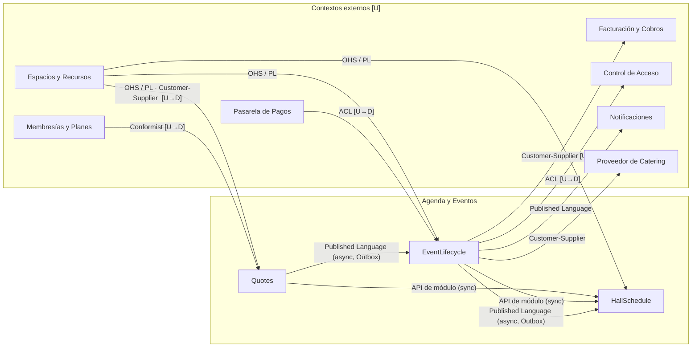

# Nodo · Agenda y Eventos

Prototipo funcional del subdominio **Agenda y Eventos** del caso Nodo (un coworking que alquila un salón polivalente para
eventos). Es el proyecto final del módulo de DDD de la Maestría en Ingeniería de Software: un **monolito modular** con
DDD táctico y Clean Architecture (.NET 10, PostgreSQL 17, React), pensado para demostrarse en video.

El criterio principal son las **22 invariantes del dominio** (`INV-01..22`): viven en los agregados y Value Objects,
son imposibles de saltar, devuelven un `code` estable con mensaje en español, tienen tests, están reforzadas en la base de
datos cuando aplica y **se pueden intentar violar desde la propia aplicación** (pantalla «Laboratorio de invariantes»).

> **Documentación**: [guion de la demo](docs/demo-script.md) · [arquitectura](docs/architecture.md) ·
> [matriz de invariantes](docs/invariants.md) · [reglas de negocio](docs/domain/business-rules.md) ·
> [bitácora de fases](docs/PROGRESS.md)

## Qué hace

Cubre el ciclo de vida de un evento en el salón, desde la perspectiva de cada actor:

1. **Cliente / Recepción** cotizan (tarifa degresiva por horas, descuento de membresía, equipos y catering) y aceptan.
2. **Dirección** aprueba o rechaza la solicitud el mismo día y fija el depósito de garantía (20–50 %).
3. La **pasarela de pagos** (simulada) notifica los pagos por webhook; al cubrirse el depósito el evento queda **confirmado en
   firme**: se consolida el bloqueo del calendario, se emite la credencial de acceso y se ordena el catering.
4. **Operaciones** inicia y finaliza el evento; Facturación liquida el saldo.
5. Una **cancelación** nunca devuelve dinero: todo lo acreditado pasa a **saldo a favor**, que sirve para **reprogramar**.

## Mapa de módulos

| Módulo | Bounded Context | Responsabilidad | Aggregates / servicios principales |
|---|---|---|---|
| `Quotes` | Cotizaciones | Presupuestos con tarifa degresiva, vigencia de 96 h, aceptación que congela el precio | `Quote`, `EventPricingCalculator`, `DegressiveRate`, `BookingPolicy` |
| `EventLifecycle` | Ciclo del Evento | Solicitud, decisión de Dirección, depósito, confirmación, ejecución, cancelación y reprogramación | `HallEvent`, `CustomerCredit`, `GuaranteeDeposit`, `CancellationPolicy` |
| `HallSchedule` | Agenda del Salón | Ocupación del salón, bloqueos provisional/definitivo, buffers y equipamiento | `HallSchedule`, `ScheduleBlock`, `AvailabilityChecker` |
| `External.Simulated` | 7 contextos externos | Espacios, Membresías, Pasarela de Pagos, Facturación, Acceso, Catering y Notificaciones (datos fijos) | Adaptadores ACL/Conformist/OHS en cada Infrastructure |

Cada módulo son 4 proyectos (`Domain`, `Application`, `Infrastructure`, `Contracts`) con su `DbContext` y *schema*
(`quotes`, `event_lifecycle`, `hall_schedule`). Un módulo nunca referencia los internos de otro: se comunican por su
Published Language (`*.Contracts`). Detalle de capas, Outbox/Inbox y secuencia central en
[`docs/architecture.md`](docs/architecture.md).

### Context map



| Relación | Patrón | Mecanismo |
|---|---|---|
| Espacios y Recursos → Agenda y Eventos | Customer/Supplier + OHS/PL | Llamada in-process a su catálogo, traducida por un adaptador de cada módulo |
| Membresías → Quotes | **Conformist** | El adaptador adopta tal cual `ACTIVE` y el porcentaje; el dominio es quien rechaza un 15 % (INV-17) |
| Pasarela de Pagos → EventLifecycle | **ACL** | Webhook con payload del proveedor (centavos, `merchant_ref`, `DECLINED`…) traducido a `AccreditDepositCommand` |
| Agenda y Eventos → Control de Acceso | **ACL** | `HallEventFirmlyConfirmed` → credencial con PIN + QR, ventana [inicio − 1 h, fin], capacidad = aforo |
| Agenda y Eventos → Facturación / Catering | Customer/Supplier | Integration events por Outbox → ledger y orden de catering |
| Agenda y Eventos → Notificaciones | Published Language | Un handler redacta un mensaje en español por cada integration event |
| Quotes → EventLifecycle, EventLifecycle → HallSchedule | **Published Language** | Integration events (Outbox → bus en memoria → Inbox); la colocación del bloqueo es una API síncrona del módulo |

## Requisitos

- **Docker** (Docker Desktop o Engine con Compose v2). Es lo único necesario para correr y evaluar el proyecto.
- Solo para desarrollo fuera de Docker: **SDK .NET 10** y **Node.js LTS** (22 o superior).

## Levantarlo en 4 comandos

```bash
git clone <url-del-repositorio> nodo && cd nodo
docker compose up --build        # db + api + web; aplica migraciones y semillas
# espera a que `web` arranque y abre http://localhost:3000
./scripts/reset.sh               # (opcional) vuelve a la BD semilla: down -v + up --build   (reset.ps1 en Windows)
```

No hay pasos manuales: la API aplica las migraciones y los datos de demostración al iniciar.

| Servicio | URL | Nota |
|---|---|---|
| **Aplicación** | http://localhost:3000 | Se elige el rol arriba a la izquierda; el reloj de demo avanza el tiempo |
| API | http://localhost:5080 | También en `http://localhost:3000/api` (nginx) |
| Scalar (API interactiva) | http://localhost:5080/scalar | Cada operación lista las `INV-xx` que puede disparar |
| Health | http://localhost:5080/health | |
| PostgreSQL | `localhost:5432` · usuario `nodo` · clave `nodo` · base `nodo` | Para `psql` o pgAdmin |
| pgAdmin (opcional) | http://localhost:5050 · `admin@nodo.local` / `admin` | `docker compose --profile tools up -d pgadmin`; registrar el servidor `db`, puerto 5432, usuario `nodo` |

`MediatR:LicenseKey` es opcional (licencia Community): si se tiene, va en `.env` (ver `.env.example`) y nunca se commitea.
Sin clave todo funciona; solo aparece un aviso de licencia en el log.

## Cómo probarlo

- **Guion paso a paso** (8–10 min, con el concepto DDD de cada paso): [`docs/demo-script.md`](docs/demo-script.md).
- **Laboratorio de invariantes**: menú «Laboratorio de invariantes» → **Probar todas** → `22/22 protegidas`.
- **Tests** (solo unitarios, sin BD): `dotnet test Nodo.slnx` — 856 tests: dominio de los tres módulos (válido / límite /
  inválido por invariante), casos de uso, adaptadores y ACL, contratos de integration events, modelo de persistencia y
  arquitectura (`NetArchTest`: capas, dependencias entre módulos y modelo *always-valid* por reflexión).
- **Front**: `cd web && npm run lint && npm run build`.

## Desarrollo local (opcional)

```bash
docker compose up -d db
dotnet build Nodo.slnx && dotnet test Nodo.slnx
dotnet run --project src/Nodo.Api          # http://localhost:5080
cd web && npm install && npm run dev       # http://localhost:5173 (Vite hace proxy de /api a 5080)
```

### Base de datos y migraciones

Cada módulo tiene su schema, su historial de migraciones y sus tablas `outbox_messages` / `inbox_messages`. La API aplica las
migraciones al arrancar (`Database:MigrateOnStartup=true`, activo en `Development` y `Docker`).

```bash
dotnet tool restore                      # instala dotnet-ef (herramienta local)
dotnet ef migrations add <Nombre> --context QuotesDbContext \
  --project src/Modules/Quotes/Nodo.Quotes.Infrastructure \
  --startup-project src/Nodo.Api --output-dir Persistence/Migrations
```

Endpoints de apoyo para la demo: `POST /api/demo/clock/advance` y `/reset`, `POST /api/demo/jobs/run` (ejecuta ya las
expiraciones), `GET /api/demo/integration-events` (eventos de integración y su entrega) y `GET /api/demo/invariants`.

## Decisiones y desviaciones respecto al documento

Origen: `docs/domain/business-rules.md`, derivado del documento «Proyecto Final: Diseño DDD - Caso Nodo». Donde el documento
era ambiguo se tomó una decisión explícita (**[Decisión]**); los valores que el documento no definía están marcados
**[Inventado]**.

| # | Decisión | Justificación |
|---|---|---|
| 1 | **Agenda del Salón = un agregado por (`HallId`, `Date`)** | Un agregado por día mantiene pequeño el límite de consistencia (el solape solo se evalúa dentro del día) y evita cargar toda la historia del salón. |
| 2 | **Buffers de 1 h de montaje y 1 h de limpieza** (BR-03) | Los 15 min del documento son de las salas de reunión, fuera de alcance. Con 1 h el solape «solo por buffer» es visible en la demo. |
| 3 | **El descuento de membresía solo aplica al alquiler del salón** (BR-07) | El documento no precisa la base; los extras tienen costo propio y el catering es de un tercero. |
| 4 | **Expiración por job** (BR-12 y BR-17): `Expired` al terminar el día de la solicitud o a las 48 h sin depósito | Es la forma de implementar «Dirección decide en el día» sin un proceso humano; el reloj de demo permite verla. |
| 5 | **El excedente de un pago pasa a saldo a favor** (BR-15) | Nunca se pierde dinero ni se devuelve: es coherente con que no existan reembolsos. |
| 6 | **Permisos solo en la UI** (BR-24) | No hay autenticación en el alcance; los comandos reciben `performedBy` para auditoría. |
| 7 | **Estados `Rejected`, `Expired` e `InProgress` añadidos; la reprogramación es una transición, no un estado** | El enum del documento no los tenía. Tratar la reprogramación como transición evita duplicar la lógica de confirmación; queda en el historial. |
| 8 | **Un agregado por transacción** (desviación del pseudocódigo 5.2) | `HallEvent` y `HallSchedule` son de BCs distintos con su propio `DbContext`. La colocación del bloqueo es **síncrona** (garantiza no solapar al crear la solicitud); consolidar o liberar es **asíncrono** por Outbox. La restricción `EXCLUDE` de PostgreSQL es la defensa final. |
| 9 | **`CustomerCredit` es un agregado de `EventLifecycle`** | «Saldo a favor» pertenece al lenguaje ubicuo de esta área; se publica a Facturación por integration events. |

Valores inventados: horario 07:00–23:00 (BR-02), anticipación de 3 a 180 días (BR-05), tarifa base 500 Bs/h con factor
degresivo (BR-06) y plazo de 48 h del depósito (BR-17).

Desviaciones de implementación (con su justificación, fase por fase) en [`docs/PROGRESS.md`](docs/PROGRESS.md): transacciones
del depósito en un `text[]`, registro global de eventos como unión de los tres outbox, reprogramación que conserva la
duración, `Api__SelfBaseUrl` en Docker, FullCalendar 6 y TypeScript 5.9.

## Trazabilidad: documento → código

| Concepto del documento / glosario | Código | Dónde |
|---|---|---|
| Evento (agregado raíz), Solicitud, Evento en Firme | `HallEvent` | `EventLifecycle.Domain/HallEvent.cs` |
| Factoría de evento | `HallEventFactory` | `EventLifecycle.Domain/HallEventFactory.cs` |
| Depósito de Garantía | `GuaranteeDeposit` (VO) | `EventLifecycle.Domain/GuaranteeDeposit.cs` |
| Saldo a Favor | `CustomerCredit` (agregado) | `EventLifecycle.Domain/CustomerCredit.cs` |
| Servicio Extra / Ítem | `ExtraServiceItem` | `EventLifecycle.Domain/ExtraServiceItem.cs` |
| Política de cancelación | `CancellationPolicy` (servicio de dominio) | `EventLifecycle.Domain/CancellationPolicy.cs` |
| Historial / decisión de Dirección | `HistoryEntry`, `ManagementDecision` | `EventLifecycle.Domain/HistoryAndDecision.cs` |
| Franja Horaria | `TimeSlot` (VO, uno por módulo) | `*.Domain/TimeSlot.cs` |
| Aforo | `Attendance` (VO) | `EventLifecycle.Domain/Attendance.cs` · `Quotes.Domain/` |
| Dinero | `Money` (VO, BOB) | `SharedKernel/Money.cs` |
| Cotización | `Quote` | `Quotes.Domain/Quote.cs` |
| Tarifa degresiva / calculador de tarifa | `DegressiveRate`, `EventPricingCalculator` | `Quotes.Domain/` |
| Desglose de precio | `PriceBreakdown` (VO) | `Quotes.Domain/PriceBreakdown.cs` |
| Reglas de reserva (horario, anticipación) | `BookingPolicy` | `EventLifecycle.Domain/BookingPolicy.cs` · `Quotes.Domain/` |
| Agenda del Salón | `HallSchedule` (agregado por salón y día) | `HallSchedule.Domain/HallSchedule.cs` |
| Bloqueo / equipamiento | `ScheduleBlock`, `EquipmentAllocation` | `HallSchedule.Domain/` |
| Verificador de disponibilidad | `AvailabilityChecker` (servicio de dominio) | `HallSchedule.Domain/AvailabilityChecker.cs` |
| Domain events → integration events | mappers `DomainEventHandler<T>` | `*.Application/DomainEventMappers.cs` · `*.Contracts/IntegrationEvents.cs` |
| Política «asignar servicios extra al confirmar» (BR-20) | `AssignExtraServicesOnConfirmed` | `EventLifecycle.Application/Policies.cs` |
| Política «cotización aceptada → solicitud» (BR-11) | `QuoteAcceptedHandler` | `EventLifecycle.Application/Policies.cs` |
| ACL de la pasarela de pagos | `PaymentGatewayAclAdapter` | `EventLifecycle.Infrastructure/ExternalAdapters.cs` |
| ACL de Control de Acceso | `AccessCredentialTranslator` | `External.Simulated/Handlers/DownstreamHandlers.cs` |
| Conformist de Membresías | `MembershipDirectoryAdapter` | `Quotes.Infrastructure/ExternalAdapters.cs` |
| API síncrona de Agenda | `IHallScheduleModuleApi` | `HallSchedule.Contracts/HallScheduleModuleApi.cs` |
| Outbox / Inbox / bus | `EfOutbox`, `OutboxProcessor`, `InboxIntegrationEventHandler`, `InMemoryEventBus` | `BuildingBlocks.Infrastructure/Messaging/` |
| Constraint de BD → 409 con `code` | `InvariantConstraintMap` | `BuildingBlocks.Infrastructure/Persistence/` |
| Reloj de demo | `DemoClock`, `ScopedClock` | `BuildingBlocks.Infrastructure/` |
| Laboratorio de invariantes | `InvariantCatalog`, `InvariantProbeRunner` | `Nodo.Api/Invariants/` |
| `INV-01..22` | ver la matriz | [`docs/invariants.md`](docs/invariants.md) |

## Estructura del repositorio

```
src/
  BuildingBlocks/   SharedKernel · BuildingBlocks.Application · BuildingBlocks.Infrastructure
  Modules/          Quotes · EventLifecycle · HallSchedule   (Domain · Application · Infrastructure · Contracts)
  External/         Nodo.External.Simulated
  Nodo.Api/         Controllers, OpenAPI/Scalar, errores, laboratorio de invariantes
web/                React 19 + TypeScript + Tailwind + TanStack Query + FullCalendar
tests/              6 proyectos de tests unitarios (xUnit, Shouldly, NSubstitute, NetArchTest)
docs/               reglas de negocio, specs por fase, arquitectura, invariantes, guion de demo
```
