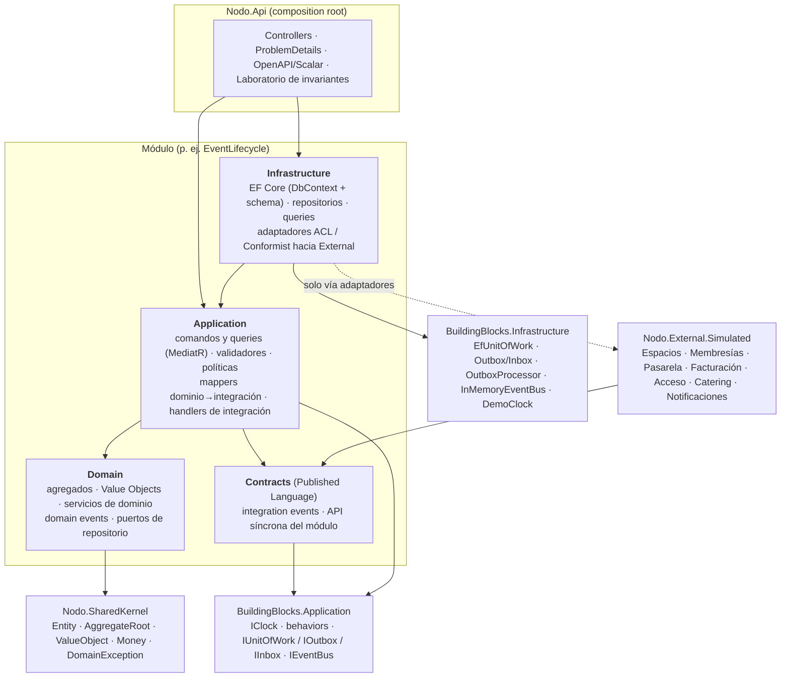
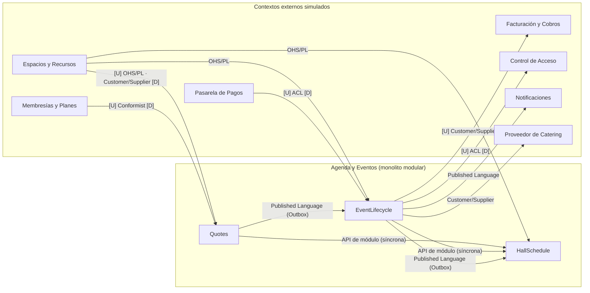
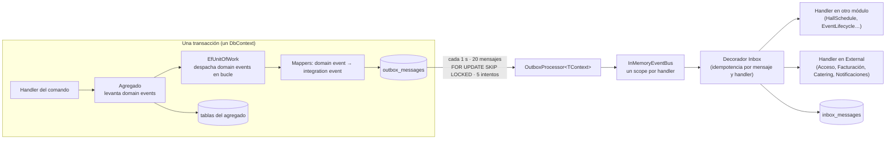
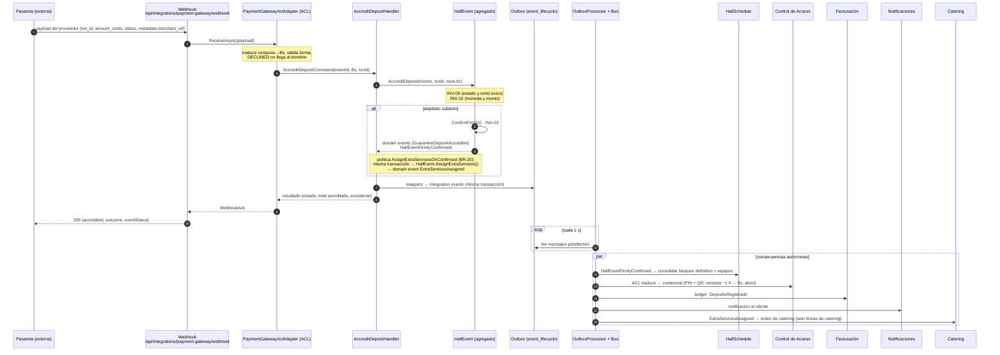

# Arquitectura

Monolito modular con DDD táctico y Clean Architecture. Tres Bounded Contexts internos (`Quotes`, `EventLifecycle`,
`HallSchedule`), cada uno con su propio modelo, `DbContext` y *schema* de PostgreSQL, que solo se conocen a través de
su Published Language (`*.Contracts`). Los siete contextos externos viven simulados en `Nodo.External.Simulated`.

## 1. Capas de un módulo

Las flechas son referencias de proyecto (el que apunta depende del apuntado). Las reglas las verifica
`Nodo.ArchitectureTests` (108 tests): el dominio no depende de nada salvo el SharedKernel, y ningún módulo toca los
internos de otro.

| Capa | Qué contiene | Qué NO puede hacer |
|---|---|---|
| **Domain** | Agregados *always-valid* (constructores privados, fábricas, sin setters), VOs, servicios de dominio y todas las invariantes. Recibe el tiempo como parámetro (`nowUtc`). | Referenciar EF, MediatR, ASP.NET, FluentValidation ni otro módulo. |
| **Application** | Un handler por caso de uso: carga, invoca al dominio, guarda. FluentValidation valida solo la *forma*. | Contener reglas de negocio ni conocer EF. |
| **Infrastructure** | `DbContext` por módulo, configuraciones Fluent, repositorios, restricciones de BD, adaptadores a los contextos externos. | Ser referenciada por Application. |
| **Contracts** | Eventos de integración (solo primitivos) y la interfaz síncrona del módulo. | Exponer tipos del dominio. |

## 2. Context map implementado

Detalle y justificación en `docs/domain/business-rules.md` §6.

## 3. Outbox / Inbox

Un agregado por transacción: cada comando cambia un solo agregado y deja los eventos de integración en la tabla
`outbox_messages` **de su propio schema, dentro de la misma transacción**. Un proceso aparte los entrega.

- **Atomicidad**: agregado + outbox se confirman con un único `SaveChanges`. Si el comando falla, no sale ningún evento.
- **Entrega al menos una vez**: el procesador reintenta hasta 5 veces y deja el error en el mensaje. El **Inbox** hace que
  repetir un mensaje no repita su efecto: cada consumidor registra `(id del mensaje, consumidor)` en su `inbox_messages`,
en la misma transacción que su trabajo; si el handler falla, no queda registrado y el mensaje se reintenta.
- **Síncrono solo donde hace falta**: colocar un bloqueo exige certeza inmediata (si el salón está ocupado, la solicitud
  no nace), así que EventLifecycle llama a `IHallScheduleModuleApi`. Consolidar o liberar es asíncrono (consistencia
  eventual, visible en la UI por el *polling*).
- **Defensa extra**: si dos comandos concurrentes chocan, la restricción `EXCLUDE`/índice único de PostgreSQL rechaza uno y
  `InvariantConstraintMap` lo traduce a 409 con el `code` de la invariante.

## 4. Secuencia central: confirmar un evento en firme

Del pago que cubre el depósito hasta sus consecuencias en los demás contextos.

## 5. Otras decisiones de diseño relevantes

- **Tiempo**: el dominio nunca lee el reloj; recibe `nowUtc`. `DemoClock` (único lugar con `DateTime.UtcNow`) permite
  adelantar el tiempo de la demo; `ScopedClock` desplaza el reloj solo dentro de una sonda de invariantes.
- **Persistencia**: un `DbContext` y un schema por módulo (`quotes`, `event_lifecycle`, `hall_schedule`), nombres en
  snake_case, concurrencia optimista con `xmin`, VOs como *complex types*, restricciones nombradas con el id de la invariante.
- **Errores**: `ProblemMapping` es la única fuente del mapeo error → HTTP: 400 forma, 404 no existe, 409 concurrencia o
  solape detectado por la BD, 422 regla de dominio con su `code`.
- **Laboratorio de invariantes**: las sondas ejecutan el caso de uso real con tres `DbContext` que comparten una conexión y
  una transacción que siempre se revierte; la demo queda intacta.
